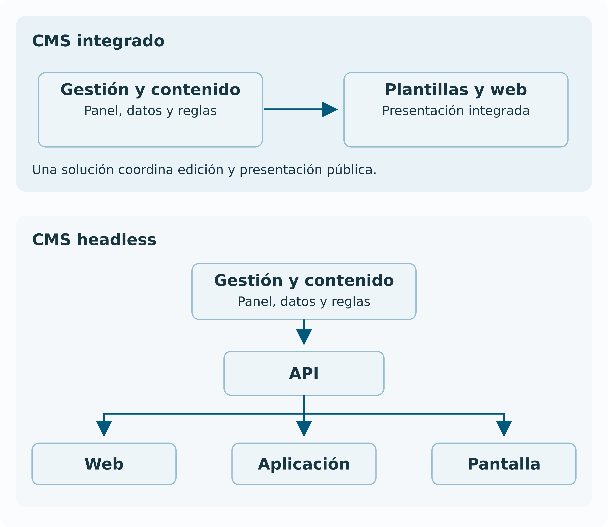

# 11. Arquitecturas de CMS y formas de publicación

## La arquitectura reparte responsabilidades

La **arquitectura de un CMS** describe cómo se organizan sus partes. Interesa saber dónde se editan y guardan los contenidos, qué componente aplica las reglas y cómo se muestran al público. Estas tareas pueden formar parte de una misma aplicación o repartirse entre varias. Por ejemplo, una aplicación puede gestionar las noticias y otra encargarse de mostrarlas en el móvil.

La elección afecta al trabajo diario. Si la edición y la presentación están integradas, el producto puede ofrecer una vista previa directa. Si intervienen aplicaciones distintas, habrá que coordinarlas para ver cómo quedará el contenido. También cambia qué sistemas debe mantener el equipo técnico.

## CMS integrado o acoplado

En un **CMS integrado o acoplado**, la misma solución gestiona los contenidos y prepara las páginas que verá el público. Por ejemplo, una editora introduce una noticia y el CMS utiliza una de sus plantillas para mostrarla en la web.

Esta integración puede facilitar el paso de editar a previsualizar y publicar. Si se desea mostrar la misma noticia en otra aplicación, habrá que comprobar cómo puede obtener sus datos. La posibilidad de reutilizarla depende de los campos definidos y de las formas de acceso que ofrezca el CMS.

Un CMS integrado también puede permitir que otras aplicaciones consulten sus contenidos mediante una API. Además, sus componentes pueden ejecutarse en varios servidores. La palabra "Integrado" se refiere a cómo se reúnen las funciones, no a que todo deba estar instalado en una sola máquina.

## Desacoplado y headless

En una arquitectura **desacoplada**, la gestión del contenido y su presentación se separan. Un **CMS headless** guarda y organiza los contenidos y permite que otras aplicaciones los consulten mediante una API. Por ejemplo, el CMS puede proporcionar los datos de una noticia y una aplicación móvil decidir cómo mostrarlos. Los proveedores no siempre utilizan estas denominaciones con el mismo alcance, por lo que conviene comprobar qué ofrece cada solución.

Quienes redactan siguen utilizando normalmente un panel de edición. La parte que se deja a otras aplicaciones es la presentación al público. Una misma noticia puede alimentar una web, una aplicación móvil y una pantalla informativa, cada una con su diseño.

*Figura 2  Comparación de CMS integrado y contenido distribuido mediante una API*

Separar estas funciones exige coordinar las aplicaciones. Hay que comprobar cómo se previsualiza un borrador, quién puede consultar los datos y cuándo una actualización aparece en cada canal. Además del CMS, la organización necesitará mantener las aplicaciones que presentan el contenido.

## APIs y contratos de datos

Una **API**, del inglés Application Programming Interface o interfaz de programación de aplicaciones, permite que un programa solicite datos o acciones a otro. Por ejemplo, una aplicación puede pedir al CMS la lista de actividades de esta semana. El **contrato de datos** establece qué se puede solicitar, qué campos se recibirán y qué significan. También deben definirse los permisos de acceso.

La [API REST de WordPress](https://developer.wordpress.org/rest-api/) permite que otras aplicaciones consulten o gestionen contenidos de ese CMS según los permisos disponibles. Es un ejemplo de cómo un producto que publica páginas web también puede ofrecer datos para utilizarlos en otras aplicaciones.

Si una aplicación espera recibir un campo llamado "Fecha de inicio" y el CMS deja de enviarlo, el calendario puede dejar de funcionar. Por eso, los cambios en los campos o en su significado deben coordinarse con quienes utilizan la API. Documentar los cambios y probar las aplicaciones conectadas ayuda a detectar estos problemas antes de publicarlos.

## Generación estática e híbrida

Un **generador de sitios estáticos** convierte los textos y otros recursos de origen en archivos preparados para publicarse. MkDocs transforma los textos de estos apuntes en páginas HTML y organiza su navegación. El [proyecto MkDocs](https://www.mkdocs.org/) describe esta herramienta.

Después de aprobar un cambio en los textos, hay que generar de nuevo las páginas y colocar el resultado en el servicio que las publica. Si alguno de esos pasos falla, el público puede seguir viendo la versión anterior, aunque el texto modificado ya esté guardado.

El contenido que utiliza un generador también puede proceder de un CMS. Por ejemplo, el equipo edita las noticias en el panel y otro proceso prepara las páginas estáticas. Una solución **híbrida** combina distintas formas de entrega. Puede mostrar páginas ya preparadas y consultar después un servicio para obtener datos que cambian con frecuencia, como las existencias de un producto.

## Caché y distribución

Una **caché** guarda una copia de un archivo o de un resultado para reutilizarlo sin obtenerlo de nuevo cada vez. Una **CDN**, del inglés Content Delivery Network o red de distribución de contenidos, utiliza servidores distribuidos para entregar recursos como imágenes y archivos. Estas técnicas pueden acelerar la carga, pero requieren controlar cuándo se actualizan o dejan de utilizarse las copias.

Supongamos que se corrige el plazo de una convocatoria y una persona sigue viendo la fecha anterior. Puede estar recibiendo una copia almacenada en caché o una página estática que todavía no se ha regenerado. Para comprobar la publicación, hay que seguir el recorrido desde el cambio guardado en el CMS hasta lo que recibe el visitante.

Las copias deben respetar los permisos. Por ejemplo, una respuesta con los pedidos de una clienta no debe reutilizarse para responder a otra. Al configurar la caché, hay que distinguir los recursos públicos de la información personal o restringida.

## Comparar por necesidades

| **Necesidad** | **Pregunta de arquitectura** |
| --- | --- |
| Un equipo editorial pequeño | ¿Puede mantener el recorrido completo sin ayuda constante? |
| Varios canales | ¿La web y la aplicación pueden reutilizar los mismos campos? |
| Previsualización precisa | ¿Se puede revisar la versión y el canal que se publicarán? |
| Información muy cambiante | ¿Cuánto tarda un cambio guardado en llegar al público? |
| Contenido restringido | ¿Se respetan permisos en web, API, archivos y cachés? |
| Independencia del proveedor | ¿Se pueden exportar datos, relaciones y activos de forma útil? |

La arquitectura debe permitir las tareas previstas con los recursos del equipo. Un sistema adecuado para una web pequeña puede resultar insuficiente para una organización con varios canales. Una solución distribuida también puede añadir trabajo de coordinación que una web sencilla no necesita.

## Comprueba la comprensión

**¿Headless significa que quien edita trabaja sin interfaz?** No. El CMS puede conservar su panel de edición. Lo que se encarga a otras aplicaciones es la presentación del contenido al público.

**¿Un sitio estático nunca consulta datos externos?** Puede hacerlo. Una página ya preparada puede utilizar JavaScript para consultar, por ejemplo, las existencias actuales de un producto y mostrarlas en el navegador.

**¿Por qué un cambio aprobado puede tardar en verse?** Porque puede faltar generar las páginas, publicarlas en el servidor o actualizar las copias almacenadas. La aprobación autoriza el cambio, pero el proceso debe comprobar también que haya llegado al público.
