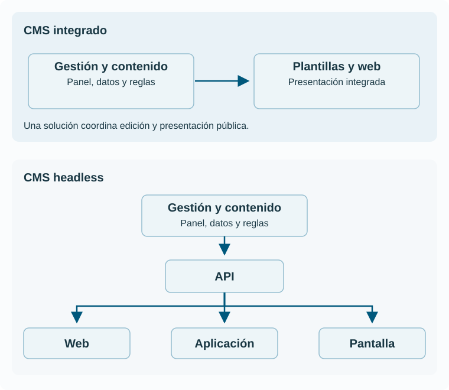

# 11. Arquitecturas de CMS y formas de publicación

## La arquitectura reparte responsabilidades

La **arquitectura** describe cómo se distribuyen las funciones del sistema y cómo se comunican sus partes. En un CMS interesa separar edición, almacenamiento, lógica de negocio y entrega al público. Estas responsabilidades pueden estar integradas en una aplicación o repartidas entre varios servicios.

La elección afecta a quienes trabajan: una arquitectura puede facilitar previsualizaciones y otra exigir coordinarlas entre aplicaciones. No es una decisión exclusivamente técnica ni una competición por utilizar el nombre más reciente.

## CMS integrado o acoplado

En un CMS **acoplado**, la gestión y la presentación pública forman parte de una solución integrada. El sistema puede almacenar contenidos y renderizar las páginas mediante sus plantillas.

Esto suele permitir un recorrido directo entre edición, vista previa y publicación. A cambio, el modelo y la presentación pueden quedar más ligados a las convenciones del producto. La capacidad real para reutilizar información depende de cómo esté modelada y de las interfaces disponibles.

Tener una arquitectura integrada no impide disponer de una API. Tampoco significa que todos los componentes se ejecuten en una única máquina. «Integrado» describe la relación de responsabilidades, no una ubicación física obligatoria.

## Desacoplado y headless

En una solución **desacoplada**, gestión y entrega están separadas. El término **headless** suele reservarse para un CMS que gestiona contenido y lo ofrece mediante interfaces, dejando a otras aplicaciones la presentación. El uso comercial de estas etiquetas no es completamente uniforme: hay que examinar la solución concreta.

El CMS headless normalmente conserva un panel para quienes editan. La «cabeza» que se separa es la presentación al público. Una web, una aplicación móvil y una pantalla pueden consumir los mismos registros, cada una con su diseño.

[Ampliar el diagrama](../assets/diagrams/arquitecturas.svg)

Esta separación exige resolver previsualización, permisos de acceso, publicación coordinada, enlaces y caché. Una organización sin equipo para mantener las aplicaciones de presentación puede encontrar más costes que ventajas.

## APIs y contratos de datos

Una **API** es una interfaz mediante la cual un sistema ofrece operaciones o datos a otro. El contrato define qué se puede solicitar, con qué formato y bajo qué reglas. Un formato como JSON representa datos; no determina por sí solo si esos datos son correctos o si su acceso está autorizado.

La [API REST de WordPress](https://developer.wordpress.org/rest-api/) es un ejemplo de acceso programático a contenidos de un CMS. Su existencia muestra que un producto conocido por servir páginas también puede participar en otras arquitecturas.

Un cambio de nombre o significado de un campo puede romper aplicaciones consumidoras. Por ello, el modelo y sus interfaces deben evolucionar de forma coordinada. Las versiones del contrato, la documentación y las pruebas de integración ayudan a mantener esa coordinación.

## Generación estática e híbrida

Un **generador de sitios estáticos** transforma fuentes en archivos preparados para servir. MkDocs, utilizado en estos apuntes, convierte documentación en un sitio navegable. El [proyecto MkDocs](https://www.mkdocs.org/) describe ese objetivo.

La generación puede ocurrir después de una aprobación editorial. Publicar implica construir el resultado y desplegarlo. El contenido no aparecerá si la construcción falla, aunque el cambio esté guardado en las fuentes.

Un CMS también puede alimentar un sitio generado estáticamente. Por tanto, «hay CMS» y «la entrega es estática» no son opciones excluyentes. Las soluciones híbridas combinan páginas preparadas, respuestas dinámicas y servicios externos según la necesidad.

## Caché y distribución

Una **caché** conserva resultados para reutilizarlos. Una **CDN** distribuye recursos desde infraestructura de entrega. Estas técnicas pueden mejorar tiempos de respuesta, pero crean la necesidad de decidir cuándo una copia deja de ser válida.

Si se corrige una fecha y algunas personas siguen viendo la anterior, el problema puede estar en una caché, en la generación del sitio o en un consumidor que no ha actualizado sus datos. La publicación debe contemplar toda la cadena.

Las respuestas personalizadas requieren especial cuidado: no debe compartirse accidentalmente una copia de información privada con otras personas. Las reglas de caché forman parte del diseño de acceso y entrega.

## Comparar por necesidades

| Necesidad | Pregunta de arquitectura |
| --- | --- |
| Un equipo editorial pequeño | ¿Puede mantener el recorrido completo sin ayuda constante? |
| Varios canales | ¿Reutilizan datos con significado o copias de HTML? |
| Previsualización precisa | ¿Se puede revisar la versión y el canal que se publicarán? |
| Información muy cambiante | ¿Cuánto tarda en propagarse una modificación? |
| Contenido restringido | ¿Se respetan permisos en web, API, archivos y cachés? |
| Independencia del proveedor | ¿Se pueden exportar datos, relaciones y activos de forma útil? |

No hay una arquitectura universalmente superior. El objetivo es que la solución responda a los requisitos con una complejidad sostenible.

## Comprueba la comprensión

**¿Headless significa que el editor trabaja sin interfaz?** No. La separación se refiere principalmente a la presentación pública.

**¿Un sitio estático nunca consulta datos externos?** Puede hacerlo desde el navegador. Hay que distinguir los archivos servidos inicialmente de los servicios que utiliza después.

**¿Por qué un cambio aprobado puede tardar en verse?** Porque aprobación, construcción, despliegue, indexación y actualización de cachés pueden ser pasos distintos. El proceso debe definir cuándo se considera completada la publicación.
