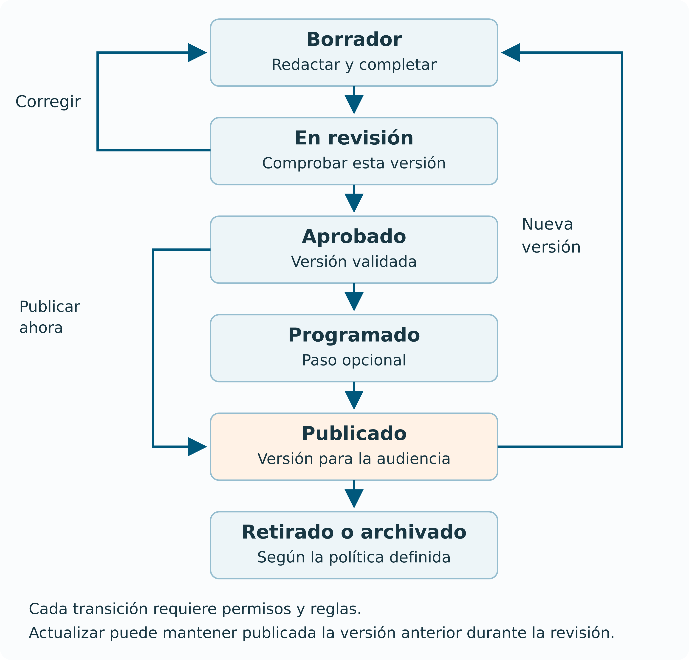

# 9. Ciclo de vida, revisión y publicación

## El contenido se gestiona antes y después de publicarse

El **ciclo de vida del contenido** recoge lo que ocurre desde que se detecta la necesidad de una pieza hasta que se retira o conserva como información histórica. Por ejemplo, una convocatoria se prepara, se revisa, se publica y se mantiene mientras está abierta. Al terminar el plazo, hay que decidir cómo indicar que ha cerrado y qué información conservar.

Una ficha puede ser correcta el día que se publica y resultar engañosa meses después. Si nadie revisa el plazo, el contacto o los requisitos, la calidad se deteriora aunque el sitio siga funcionando técnicamente.

El **flujo de trabajo** establece los pasos y las personas que intervienen. Por ejemplo, la redactora prepara la convocatoria, la unidad responsable comprueba sus requisitos y una persona autorizada la publica. El CMS puede ayudar a aplicar esos pasos y registrar las decisiones, siempre que se haya configurado para ello.

## Estados y transiciones

Un **estado** indica en qué situación se encuentra el contenido, como "Borrador" o "Publicado". Una **transición** es el paso de un estado a otro. Por ejemplo, "Enviar a revisión" puede cambiar un borrador al estado "En revisión". El sistema puede exigir un permiso o comprobar que se hayan rellenado determinados campos antes de permitir ese cambio.

| **Estado del ejemplo** | **Qué significa** | **Quién tiene la siguiente tarea** |
| --- | --- | --- |
| Planificado | Necesidad aceptada y responsable asignado. | Redacción. |
| Borrador | Se está preparando la pieza. | Redacción. |
| En revisión | Versión entregada para comprobarla. | Revisión. |
| Aprobado | Contenido validado para una publicación concreta. | Publicación. |
| Programado | Aprobado con fecha de salida prevista. | Publicación y mecanismo de programación. |
| Publicado | Versión disponible para su audiencia. | Responsable de mantenimiento. |
| Retirado o archivado | Ha dejado de ofrecerse como contenido vigente. | Responsable y política de conservación. |

La tabla presenta un posible proceso de trabajo. Los nombres y estados disponibles dependen del CMS y de su configuración. Además, "Archivado" puede significar que una página sigue visible como información histórica o que deja de estar disponible al público. La organización debe aclarar qué ocurrirá en su caso.

*Figura 1  Flujo editorial con devolución a borrador y actualización de una publicación*

Si la revisión detecta un error, la pieza puede volver a borrador acompañada de observaciones para corregirlo. La aprobación debe referirse a una versión concreta. Si después se cambia un requisito importante, puede ser necesario solicitar otra revisión antes de publicar.

## Qué se revisa

La **revisión factual** comprueba que los datos sean correctos. Por ejemplo, contrasta el plazo con la convocatoria oficial. La **revisión editorial** comprueba que la explicación sea clara y esté bien organizada. La **revisión funcional** comprueba que los enlaces y formularios funcionen. Según el contenido, también puede hacer falta revisar los derechos de uso de imágenes o la accesibilidad.

Los criterios de revisión deben indicar qué hay que comprobar. En una convocatoria, interesa confirmar el plazo, los requisitos y el enlace para solicitarla. En una ficha de producto, puede ser necesario revisar la composición, las tallas, las fotografías y el precio. Una pregunta general como "¿Está bien?" no indica qué comprobaciones se esperan.

Debe quedar registrado qué versión se ha aprobado. Si una persona da su conformidad por correo y el texto sigue cambiando, podría publicarse información que nunca examinó. Vincular la aprobación a una versión permite saber qué contenido recibió esa autorización.

## Revisión editorial e historial de revisiones

La palabra **revisión** tiene dos sentidos que conviene separar. Puede significar la comprobación de una pieza por una persona. También puede designar una versión guardada en el historial del CMS.

El [sistema de revisiones de WordPress](https://wordpress.org/documentation/article/revisions/) permite comparar cambios y restaurar revisiones. Esto no implica que una segunda persona haya aprobado cada una. Guardar versiones y exigir revisión editorial son capacidades distintas.

El historial permite consultar las versiones que el CMS conserva y puede indicar quién realizó cada cambio y cuándo. Es útil acompañar cambios importantes de una explicación, como "Corrección del plazo según la nueva convocatoria". Debe comprobarse qué guarda ese historial, porque puede incluir el texto y no conservar del mismo modo los archivos adjuntos o la configuración.

## La versión pública y el borrador de actualización

Un CMS puede permitir preparar una actualización mientras el público sigue viendo la versión aprobada. El [módulo Content Moderation de Drupal](https://www.drupal.org/docs/8/core/modules/content-moderation/overview) documenta este funcionamiento. La nueva copia puede pasar por revisión antes de sustituir al contenido que está publicado.

No todos los productos o configuraciones se comportan así. En algunos, guardar un cambio sobre un contenido publicado lo hace visible inmediatamente. Antes de organizar el proceso hay que verificar qué guarda cada botón y cuál es su efecto público.

**Ejemplo.** La versión 3 de una ficha de servicio está publicada. Una editora prepara la versión 4 con nuevos requisitos y la envía a revisión. Mientras tanto, el público sigue consultando la versión 3. Cuando se aprueba y publica la versión 4, esta pasa a ser la visible. La versión más reciente guardada no siempre es la que ya se ofrece al público.

## Autoguardado, historial, auditoría y copia de seguridad

| **Mecanismo** | **Qué pretende resolver** | **Qué no debe suponerse** |
| --- | --- | --- |
| Autoguardado | Recuperar trabajo reciente de edición. | Que conserva indefinidamente todo el historial. |
| Historial de contenido | Comparar versiones de una pieza o recuperar una anterior. | Que incluye todos los archivos y ajustes. |
| Registro de auditoría | Registrar quién realizó acciones como publicar o borrar. | Que contiene una copia restaurable completa. |
| Copia de seguridad | Recuperar datos o servicio ante pérdida o fallo. | Que identifica por sí sola qué texto aprobó una revisora. |

Recuperar una versión anterior de una noticia actúa sobre esa pieza. Restaurar una copia de seguridad puede afectar a muchos contenidos y a la configuración del sistema. Además de crear copias, hay que probar que permiten recuperar la información y volver a utilizar el servicio. El [capítulo 16](seguridad-mantenimiento.md#16-seguridad-privacidad-y-mantenimiento) explica estas tareas.

## Edición concurrente y conflictos

Si Ana y Luis abren la misma noticia, ambos pueden empezar a editar una copia del texto. Si Ana guarda primero y Luis guarda después, el segundo guardado podría perder los cambios de Ana. Para evitarlo, el CMS puede bloquear la edición simultánea, mostrar un aviso o comprobar si la versión ha cambiado. El autoguardado, por sí solo, no garantiza que se resuelva ese conflicto.

Cuando se detecta un conflicto, el equipo necesita comparar las dos propuestas y decidir qué conservar. Por ejemplo, puede combinar la nueva fecha introducida por Ana con la corrección de contacto realizada por Luis. Conviene conocer cómo avisa el CMS y quién se encargará de resolver estos casos.

## Programación, caducidad y zona horaria

Para programar una publicación hay que indicar una fecha, una hora y una zona horaria. "El lunes a las nueve" puede significar momentos distintos para un equipo que trabaja en varios países. Después debe comprobarse que la publicación se haya ejecutado correctamente. Guardar una fecha prevista no garantiza por sí solo que el contenido haya aparecido.

El fin de la vigencia no siempre coincide con la eliminación. Una convocatoria cerrada puede conservarse como información histórica, claramente marcada y sin inducir a presentar solicitudes. Una promoción caducada puede retirarse de sus accesos y actualizar sus relaciones con productos.

## Mantenimiento, retirada y dependencias

Antes de retirar una pieza, conviene localizar dónde se utiliza. Una convocatoria puede aparecer en un menú, un listado, el buscador y una versión traducida. Esos accesos deben revisarse para evitar que sigan presentándola como abierta. Si se elimina una imagen compartida, también pueden verse afectadas otras páginas que la muestran.

Retirar contenido puede requerir acciones distintas. **Despublicar** lo deja fuera de la vista pública sin borrarlo necesariamente. **Restringir** limita quién puede consultarlo. **Redirigir** envía al visitante a otra dirección. **Archivar** lo conserva según la política acordada y **eliminar** lo borra. Hay que elegir la opción que corresponda al contenido y a las necesidades de conservación.

## Comprueba la comprensión

**¿Por qué no basta con guardar la aprobación en un correo?** Porque hay que vincularla de forma inequívoca a la versión que se publicará y a los criterios revisados.

**¿Restaurar un texto anterior debe publicarlo automáticamente?** Depende del flujo, pero la restauración puede requerir revisión. Una versión antigua también puede contener datos caducados.

**¿Qué debe ocurrir después de publicar?** Comprobar que el contenido se muestra correctamente, mantener un responsable y revisar la información cuando corresponda. Por ejemplo, al cerrar una convocatoria debe indicarse que ya no admite solicitudes.
