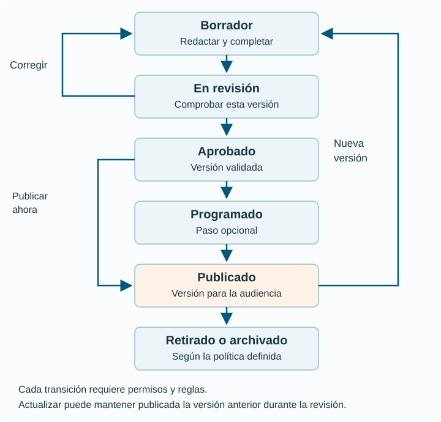

# 9. Ciclo de vida, revisión y publicación

## El contenido se gestiona antes y después de publicarse

El **ciclo de vida del contenido** abarca la detección de una necesidad, planificación, creación, revisión, publicación, mantenimiento y retirada. Publicar es un momento del proceso, no su final.

Una ficha puede ser correcta el día que se publica y resultar engañosa meses después. Si nadie revisa el plazo, el contacto o los requisitos, la calidad se deteriora aunque el sitio siga funcionando técnicamente.

El **flujo de trabajo** concreta qué pasos se siguen, quién interviene y qué condiciones permiten avanzar. El CMS puede ejecutarlo y registrar acciones, pero la organización debe diseñarlo.

## Estados y transiciones

Un **estado** describe una situación: borrador o publicado. Una **transición** es un cambio permitido entre estados: enviar a revisión o publicar. Cada transición puede exigir permisos, validaciones y una decisión humana.

| Estado del ejemplo | Qué significa | Quién tiene la siguiente tarea |
| --- | --- | --- |
| Planificado | Necesidad aceptada y responsable asignado. | Redacción. |
| Borrador | Se está preparando la pieza. | Redacción. |
| En revisión | Versión entregada para comprobarla. | Revisión. |
| Aprobado | Contenido validado para una publicación concreta. | Publicación. |
| Programado | Aprobado con fecha de salida prevista. | Publicación y mecanismo de programación. |
| Publicado | Versión disponible para su audiencia. | Responsable de mantenimiento. |
| Retirado o archivado | Ha dejado de ofrecerse como contenido vigente. | Responsable y política de conservación. |

Estos estados son un modelo didáctico. No todos los CMS los incluyen de serie y «archivado» puede tener significados distintos. En un sistema puede conservar una página pública histórica; en otro, dejarla fuera de la publicación. La política debe aclararlo.

[Ampliar el diagrama](../assets/diagrams/flujo-editorial.svg)

Un rechazo no tiene por qué eliminar la pieza. Puede devolverla a borrador con observaciones. Una aprobación tampoco debería sobrevivir automáticamente a cualquier cambio posterior: si se modifica una condición relevante, quizá haya que revisar de nuevo.

## Qué se revisa

La **revisión factual** comprueba datos y fuentes. La **revisión editorial** evalúa claridad, estructura, tono y consistencia. La **revisión funcional** comprueba enlaces, formularios, relaciones y presentación. Pueden existir revisiones especializadas de derechos, accesibilidad u otros requisitos según el contenido.

No basta con preguntar «¿está bien?». Para una convocatoria se necesita verificar plazo, audiencia, requisitos y destino de la solicitud. Para un producto, composición, variantes, imágenes y coherencia con los datos comerciales. Los criterios deben ser concretos y proporcionados.

La revisión debe registrar qué versión se ha examinado. Aprobar un texto por correo mientras la ficha sigue cambiando crea una ambigüedad: puede publicarse algo diferente de lo aprobado.

## Revisión editorial e historial de revisiones

La palabra **revisión** tiene dos sentidos que conviene separar. Puede significar la comprobación de una pieza por una persona. También puede designar una versión guardada en el historial del CMS.

El [sistema de revisiones de WordPress](https://wordpress.org/documentation/article/revisions/) permite comparar cambios y restaurar revisiones. Esto no implica que una segunda persona haya aprobado cada una. Guardar versiones y exigir revisión editorial son capacidades distintas.

Una revisión guardada debería permitir entender quién cambió qué y cuándo. Una explicación del motivo ayuda especialmente cuando se corrigen cifras, requisitos o condiciones. No siempre se versionan todos los campos, archivos o configuraciones: hay que conocer el alcance real del CMS.

## La versión pública y el borrador de actualización

Cuando una página publicada necesita cambios, interesa que la versión vigente siga disponible mientras se prepara otra. El [módulo Content Moderation de Drupal](https://www.drupal.org/docs/8/core/modules/content-moderation/overview) documenta este patrón: una versión publicada puede coexistir con una copia de trabajo en revisión.

No todos los productos o configuraciones se comportan así. En algunos, guardar un cambio sobre un contenido publicado lo hace visible inmediatamente. Antes de organizar el proceso hay que verificar qué guarda cada botón y cuál es su efecto público.

**Ejemplo.** La versión 3 de un servicio está publicada. La versión 4 introduce nuevos requisitos y queda en revisión. El público sigue leyendo la 3 hasta que se aprueba y publica la 4. «Existe una versión más reciente» no equivale a «esa versión es la vigente para el público».

## Autoguardado, historial, auditoría y copia de seguridad

| Mecanismo | Qué pretende resolver | Qué no debe suponerse |
| --- | --- | --- |
| Autoguardado | Recuperar trabajo reciente de edición. | Que conserva indefinidamente todo el historial. |
| Historial de contenido | Comparar o recuperar estados de una pieza. | Que incluye todos los archivos y ajustes. |
| Registro de auditoría | Atribuir acciones relevantes. | Que contiene una copia restaurable completa. |
| Copia de seguridad | Recuperar datos o servicio ante pérdida o fallo. | Que identifica por sí sola qué texto aprobó una revisora. |

Restaurar una revisión no equivale a restaurar una base de datos. Y disponer de copias no garantiza poder recuperarse: hay que comprobar restauración y consistencia. El [capítulo 16](seguridad-mantenimiento.md) trata esta dimensión.

## Edición concurrente y conflictos

Si dos personas editan la misma pieza, una puede sobrescribir los cambios de la otra. Los sistemas pueden utilizar bloqueos, avisos de edición o comprobaciones de versión. La presencia de autoguardado no elimina necesariamente el conflicto.

Una regla útil es que el guardado detecte si el registro cambió desde que se abrió. El equipo debe tener un procedimiento para comparar y combinar cambios. Hacer responsable a una persona de cada pieza reduce ambigüedades, pero no sustituye las protecciones técnicas.

## Programación, caducidad y zona horaria

Programar una publicación exige una fecha, una hora y una referencia temporal. «El lunes a las nueve» es insuficiente para equipos en varios países. También hace falta que el mecanismo programado se ejecute y se supervise.

El fin de la vigencia no siempre coincide con la eliminación. Una convocatoria cerrada puede conservarse como información histórica, claramente marcada y sin inducir a presentar solicitudes. Una promoción caducada puede retirarse de sus accesos y actualizar sus relaciones con productos.

## Mantenimiento, retirada y dependencias

Retirar una pieza exige revisar sus usos: menús, listados, enlaces, traducciones, APIs y archivos asociados. Si una ficha desaparece pero sigue apareciendo en el buscador, la experiencia queda incoherente. Si se elimina un activo compartido, pueden romperse varias páginas.

La retirada puede implicar despublicar, restringir, redirigir, archivar o eliminar. Estas acciones no son equivalentes. La conservación debe responder a una política concreta y a los requisitos aplicables al contenido.

## Comprueba la comprensión

**¿Por qué no basta con guardar la aprobación en un correo?** Porque hay que vincularla de forma inequívoca a la versión que se publicará y a los criterios revisados.

**¿Restaurar un texto anterior debe publicarlo automáticamente?** Depende del flujo, pero la restauración puede requerir revisión. Una versión antigua también puede contener datos caducados.

**¿Qué debe ocurrir después de publicar?** Comprobar el resultado y mantener responsabilidad, calendario de revisión y mecanismos de retirada. La publicación inicia una etapa de servicio al público.
